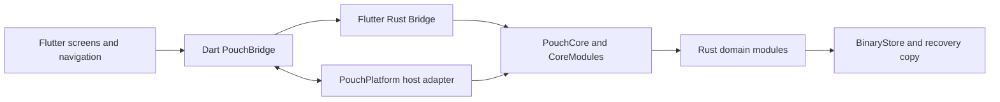

# Pouch architecture

Pouch uses shared Flutter presentation and a Rust application core for Android and the Windows/Linux desktop runners. Version 2 desktop packages passed manual build and runtime validation on Ubuntu 26.04 x64 and Windows 11. Components run locally and communicate through a typed Flutter Rust Bridge. PouchPlatform supplies host services through AndroidPouchPlatform or DesktopPouchPlatform.

The updated interface and explicit-period flows have been manually tested on Android and Linux. The Linux desktop workflow checks formatting, linting, tests, and release packaging on each push to main.

## Component ownership

### Flutter

Flutter owns page navigation, forms, dialogs, localization, presentation, and temporary screen state. The application shell uses persistent desktop navigation and compact mobile navigation with a More sheet. About is reached from Settings and keeps Settings selected in navigation. Shared cards, statistics, empty states, form themes, and a purchase editor are reused across the redesigned screens. Classic retains the cream and brown palette. Locally bundled Vazirmatn provides interface typography; Amiri remains the PDF report font. Persian RTL and English LTR follow the selected locale; calendar conversion and all period/business validation remain in Rust. Feature screens request complete snapshots and reports from Rust; budget rules stay out of the widgets.

PouchBridge is the app-facing Dart boundary for Rust commands and platform services. Generated bridge files adapt typed Rust APIs to Dart. Keep feature logic in the hand-written app and core modules rather than generated adapters.

### Android platform adapter

MainActivity supplies the private app-data directory and saved JSON candidates to the Rust core. It also owns Android file selection for backup and restore, external URL opening, and native PDF printing. Pouch does not depend on a hosted account or backend service.

Platform services stay behind the host adapter. Country defaults, date and calendar rules, income scheduling, budget calculations, report generation, and state validation are implemented in shared Flutter or Rust code without Android-specific assumptions.

### Desktop platform adapter

DesktopPouchPlatform owns the per-user data directory, process storage lock, theme file, bounded backup reads and atomic backup exports. Flutter plugins provide native dialogs, external URL handling and PDF printing. The report screen prepares a localized PDF from the existing Rust report and calendar formatter, with bundled fonts and explicit PDF export. Android retains its HTML print path.

Desktop runners bundle pouch_core.dll on Windows and libpouch_core.so under lib/ on Linux. The hand-written pouch_runtime.dart initializer loads the library by an explicit path relative to the executable; generated bindings and Rust domain APIs are unchanged. Cargokit resolves the Rust manifest from the real plugin directory, including Flutter plugin symlinks.

### Rust core

PouchCore exposes the application operations used by Flutter. CoreModules owns the validated state, revision, storage boundary, and single-step undo state. It constructs focused feature services with explicit dependencies.

Domain modules own money, dates, calendar conversion, income, budget plans, purchases, expenses, savings goals, reports, and preferences. Money is represented as integer minor units. Stored dates use canonical Gregorian day values; the selected calendar controls display and date entry.

## Numbered pagination

`rust/src/pagination.rs` provides stateless `Pagination` and `Page<T>` values. Pages start at 1, and page sizes must be between 1 and 100. Invalid requests return `PouchError::InvalidPagination`. Range calculation handles integer overflow safely; empty and out-of-range pages keep the requested page number and return no items. `total_items` counts the complete filtered list before pagination.

Feature modules own filtering and sorting. `income::list` and `income::list_expected` use newest dates first, then ID. `purchases::list` selects a day and orders purchases by ID. `expenses::list_planned` accepts optional kind and status filters and orders by due date, then ID. `Report::entries_page` and `Report::planned_page` order by date, then ID, and paginate details from a complete report. These read-only queries never change stored record order, revisions, or undo state.

Financial calculations, report totals, forecasts, backups, and application snapshots continue using complete data. Pagination adds Rust query APIs only; Flutter screens and generated bridge bindings continue using their existing APIs. There is no pagination manager, runtime service, handle, or event.

Manual validation: run `cargo fmt --manifest-path rust/Cargo.toml`, `cargo clippy --manifest-path rust/Cargo.toml --all-targets --locked -- -D warnings`, and `cargo test --manifest-path rust/Cargo.toml --locked`. Run the host validation/build script for application validation before synchronizing the repository.

## Command and persistence flow

For a write, Flutter calls a typed Rust command. Rust validates the request, prepares and validates the next complete state, writes it, then publishes the new state and revision. If validation or storage fails, the active state remains unchanged.

BinaryStore stores the app state in a versioned binary envelope with a format marker, payload length, and checksum. It writes a temporary file in the private app-data directory and atomically replaces the primary file after the new data has been validated. A recovery copy is kept so startup can use the last known good state if the primary file cannot be read.

At startup, Rust checks the binary store and its supported recovery copy. Incompatible development formats and nonempty legacy JSON candidates are rejected without migration. An explicitly confirmed incompatible-data reset archives the original binary files in an `incompatible-<timestamp>` directory before starting fresh. Portable JSON restore validates the current format before replacing state.

## Backup and platform boundaries

Rust owns JSON backup parsing, schema validation, and conversion to app state. Flutter owns the backup screens and confirmation flow. The selected platform adapter supplies the system file picker and printing services. Reports are calculated in Rust; Flutter formats Android HTML or desktop PDF without adding accounting rules.

Preferences own the selected country, language, currency, calendar, and week start. Country applies regional defaults for currency, calendar, and week start. Users can still adjust the calendar and week start, and the existing Persian-language behavior continues to select the Jalali calendar when Persian is first selected. English and Persian strings live in Flutter localization files. Language controls text direction; calendar selection controls date interpretation.

Expected income is stored separately from recorded income. It appears in the income calendar and can be edited, removed, or marked received. Budget, savings, and reports use recorded income only, so forecasts do not fund spending before the user confirms receipt.

Budget periods are explicit persisted records owned by `periods`. Stable IDs such as `BP-001` do not depend on dates. PeriodContext stores a collision-checked generated display name for each ID, plus explicit income and planned-item period associations. Names are generated from the standard library random hash seed and persisted once; these labels are not security tokens. Starts are inclusive and ends exclusive. The final period ends at its user-defined planning horizon; reaching it never creates another period or income. Weekly, biweekly, anchored Gregorian/Jalali monthly, custom-day, and irregular choices calculate a suggested horizon in Rust. The Income Calendar combines date selection, amount entry, and an explicit save button. Its selected period is saved independently of the receipt date. Period creation remains a separate explicit action. Starting a new period closes the predecessor at the new start. Multiple same-day receipts can join the same period; a second period on an existing start date is rejected.

Editing a boundary adjusts its adjacent period and rebinds dated plans and allocations by date while keeping IDs stable. Invalid, overlapping, empty, or orphaned plan/allocation ranges are rejected before storage changes. Dates outside all saved periods have no daily recommendation, but cash, obligations, and protected balances remain visible. Financial records remain dated ledger entries; rollover never copies income or purchases.

Period plans contain dated minimum-savings revisions. Every revision can be deleted with confirmation and transaction-level undo. Deleting an effective or historical revision rebuilds allocations from that date through today at saved allocation dates, income/purchase dates, remaining revision dates, and period starts. Earlier allocations and cash ledger records are retained; remaining savings revisions and goals still apply. Future revision deletion does not rewrite allocations. Essential bills have independent recurrence and due dates. Rust projects occurrences, preserves paid or stopped occurrences, and exposes period inspection and aggregated income-calendar data. Multiple received or expected incomes can share a date. Confirming expected income preserves its original expectation, records the actual date and amount, and uses the same explicit period choice as any other receipt.

Cash is all received income minus all actual purchases through the selected date, regardless of budget association. Period income totals use saved associations and the inspection date; expected income remains excluded. Explicitly assigned targets are grouped and forecast within their assigned period even when due dates fall outside it. Existing unassigned income retains date-based membership, while existing unassigned targets retain their previous cross-period visibility. New and edited UI entries save an explicit association. Future-assigned ordinary expenses are reserved in their assigned period, and due or overdue unpaid expenses continue to reserve cash across periods. Pending ordinary expenses, overdue essential bills, and essential occurrences through the horizon (including the next occurrence) are reserved in full. This conservative policy protects a monthly bill during weekly budgeting. Essential costs are a subset of the expense reservation, not another deduction. Snapshots distinguish the complete unpaid obligation total from the portion of reservations funded by actual cash. Savings are capped by remaining positive cash. Free funds equal cash minus expenses minus funded savings; deficits survive rollover. Daily recommendations divide remaining free funds across remaining period days and account for today's discretionary purchases. Linked bill/goal payments are excluded from discretionary spending because their reserved funds already cover them.

The savings module records dated allocation changes during successful mutations. Earlier-date entries are retained when goals change, while today's entry is recalculated idempotently. It allocates the greater of the period minimum and cumulative deadline contributions, subject to actual available cash. Goal payments consume the shared balance. Reconciliation can release savings when corrected spending or obligations reduce available funds. Corrections to received income, purchases, payments, and effective savings plans reconcile at the affected date as well as the current date in the enclosing transaction. Editing a goal alone preserves allocations on earlier dates. Read-only previews never create allocations or persistence writes.

Plans groups expenses and savings goals using shared target editing/payment components and Rust-calculated allocations. Today owns the selected daily date and embeds the purchase component for that day. The same component provides searchable history within Today, receiving current snapshots after edits and undo. Future-day creation uses savePlanned, not addPurchase; pending expense rows share editing, deletion, and payment dialogs with Plans through planned_item_widgets.dart. Marking an item paid uses the existing Rust command and the actual payment date. Daily paid rows come from dated purchases, while pending rows come from planned expenses, so paid plans are not shown twice. Goals remain in Plans. The application retains the selected date across navigation; current-day selections follow midnight while historical selections remain fixed. Budget details are expandable, and periods use a compact date summary with expandable history. Future daily amounts are explicitly estimates. Savings presentation says Set aside for savings and explains that the app does not transfer or lock funds. Bounded summary rows keep labels and amounts together on desktop and stack them on narrow or enlarged-text layouts. A periodic presentation refresh and resume refresh update the date and Rust snapshot across midnight. The goal forecast bridge includes completion_days and daily_reduction; regenerate its typed adapters after API changes before validation.

Presentation feedback uses PouchMotion, a short coin burst after successful income receipt, an increase in minimum savings, or creation of a daily purchase, planned expense, or savings goal. Future purchases created from Today share the planned-expense save feedback. Cancelled, rejected, and existing purchase/target edits do not trigger creation bursts. Twelve vector coins share one controller and repaint only their isolated overlay; the overlay ignores pointer events and semantics, is removed on completion, and repeated requests restart it rather than accumulate effects. Page changes use a brief fade and small vertical offset. System reduced-motion preferences disable both effects. PouchCoin supplies shared vector artwork with a shaded edge, raised emblem, and projected face width for a three-dimensional rotation effect. A small branded coin appears beside Pouch on desktop, mobile, and About. Its six-second rotation repaints only its own boundary, stops for reduced motion, disabled ticker mode, and background lifecycle states, and resumes in the foreground. Continuous-rotation widget tests advance bounded frames rather than waiting for all animations to settle. Animation controllers and lifecycle observers are disposed with their widgets; no particle package, bitmap asset, or timer loop is used. Runtime performance and visual acceptance require manual validation.

The current stored schema adds PeriodContext without rewriting financial dates, IDs, payment links, allocations, or amounts. Binary envelope 4/schema 6 reads the immediately previous envelope 3/schema 5 through a dedicated adapter and persists the upgrade with the original recovery copy retained. Portable backups export version 9 and import versions 8 and 9. Older unsupported formats still require the explicit archival flow; the legacy WebView stack is untouched.

## Source map

### Financial forecast preview

The dedicated Financial Forecast page reads pending expenses and savings goals created in Planned Expenses. The Rust forecast module owns calculations; Flutter owns a shared target selector, the recommendation income-basis selector and presentation. The read-only API never changes state, persistence, revision, or undo history.

Personal Forecast exposes its period selector at the top. PouchPeriodScope shares the selected ID between Budget Plan, Today, Plans, and Personal Forecast, initially using the active period. Each selector has a short explanation, and Today identifies the period by name. The chosen daily date remains independent, with an explicit inspection-date caption when the period preview is clamped. Rust supplies period-specific targets using saved associations. Rust clamps historical previews to the last included day and future previews to the first day; Today uses the shared selected period for its budget preview while retaining its own selected calendar day. Historical summaries show actual spending, the saved minimum-savings plan, period savings contributions, and closing protected/free balances. The personal preview uses actual cash, existing reservations and allocations, remaining days, and observed discretionary spending. Carried free cash is usable once in the current horizon; any completion beyond it assumes a similar rate of actual received income and unchanged spending, without repeating opening cash or treating expected income as received. Improvements preview 10% lower discretionary spending or hypothetical income needed for commitments. All previews are read-only.

Goal allocations reuse the savings balance. Expenses use received cash remaining after funded savings, capped by outstanding expense reservations. Each pool is allocated once in target-date and ID order. Deadline rates use cumulative remaining amounts within each pool; required income covers both pools, the everyday allowance, and the configured savings minimum. Essential bills are already included in the expense pool. An unfunded due or overdue commitment has no finite deadline income requirement.

Completion projects the remaining cumulative amount at the income left after essential costs, everyday spending, and the other pool's deadline commitments. It assumes similar future received income and unchanged costs, with earlier targets funded first. It is unavailable without positive capacity or when the projected date is outside the supported date range. A fully allocated target completes today with zero days remaining. Hypothetical income and spending never change today's funded budget.

The completion date is calculated in Rust as the forecast date plus remaining days. Flutter converts it through the existing calendar API and displays day/month/year (DD/MM/YYYY) using the selected calendar and localized digits, beside the number of days remaining. Both English and Persian are supported.

Typed adapters are regenerated after Rust API changes. See docs/FINANCIAL_FORECAST.md for manual validation.

- flutter/lib/features contains the Preferences, Budget Plan, Today, Planned Expenses, Financial Forecast, Reports, and About screens.
- flutter/lib/core contains the Dart bridge wrapper, models, formatters, theme, and localization helpers.
- flutter/android contains the Android application shell.
- flutter/windows and flutter/linux contain desktop runners.
- flutter/lib/core/pouch_platform.dart owns the OS service boundary.
- flutter/lib/features/reports/report_pdf.dart and desktop_report_dialog.dart own desktop PDF presentation.
- docs/DESKTOP.md documents manual builds and acceptance.
- rust/src/api contains the typed application API exposed through the bridge.
- rust/src/core contains state ownership and command coordination.
- rust/src/periods, rust/src/budget, rust/src/income, rust/src/purchases, rust/src/expenses, rust/src/savings, rust/src/goals, rust/src/reports, and rust/src/preferences contain domain operations.
- rust/src/storage and rust/src/backup contain persistent storage and portable backup handling.

### Economic Profiles and Standard Forecast

Financial Forecast owns a personal period/target selection, a current forecast, expandable improvement previews, and an expandable country comparison with a separate target selection tied to today. Income basis switches only the recommendation between recorded and required income. The typed bridge carries the basis, essential/configured amounts, extra days and faster-day comparisons, requiring regeneration before validation. Flutter shares responsive metric grids across personal and country results. Forecast previews never mutate financial state.

The `economics` Rust module retrieves and validates public economic data, caches it independently from financial storage, and calculates a read-only Standard Forecast from the selected target's remaining allocation. Canada retains its provider mapping; international adapters cover the other five OECD countries and Iran. Iran is explicitly an urban household scenario rather than an individual salary estimate. The existing JSON API carries converted goal amounts, deadline saving/income requirements and benchmark completion estimates. Flutter presents compact metrics, expandable source details, refresh status and optional customization. Downloading runs outside the opaque financial session so the core is not held across network calls. Personal financial data are never sent to providers. Source mappings and manual acceptance checks are documented in `docs/ECONOMIC_PROFILES.md`.

Explicit custom assumptions use existing AppState persistence and JSON backups. Binary envelope 4/schema 6 preserves custom assumptions while upgrading the immediately previous envelope 3/schema 5. JSON backup 9 exports current metadata and also imports backup 8 through the compatibility adapter. Cached statistics use a separate versioned JSON file with atomic recovery and never clear financial undo or overwrite custom assumptions. Country profiles use ISO codes independently of Settings' initial country enum. Source mappings, formulas, limitations and required manual validation are documented in [Economic Profiles](docs/ECONOMIC_PROFILES.md). The Version 2 application builds and automated validation passed; see [release verification](docs/RELEASE_V2.md).

SCI retrieval uses a separate TLS client in `economics::sci_tls`. A reviewed public intermediate is supplied only to the normal verifier's chain-building input for the two official SCI hosts; root trust, hostname/date checks and handshake signatures are unchanged. Other providers keep their existing client. Iran failures are categorized by request/TLS, HTTP, body, parsing, validation and cache stage. Runtime SCI HTML parsing remains temporary; a reviewed versioned JSON dataset is planned separately.

## Period refactor validation and deferred work

The refactor includes regression coverage for boundaries, multiple income entries, receipt timing, bill recurrence and payment links, rollover, allocation conservation, expired horizons, and format rejection. Compilation, linting, tests, and platform builds require manual execution; source parsing and binding generation do not establish runtime correctness.

Necessary changes are the Rust period/accounting model, current-format persistence, typed bridge, period inspection and bill controls, localization, regression coverage, and documentation. Optional later work includes copying savings defaults to future periods, reminder notifications, partial bill payments, richer scenario planning, and additional performance indexing. None requires a legacy calculation engine or data migrations.
