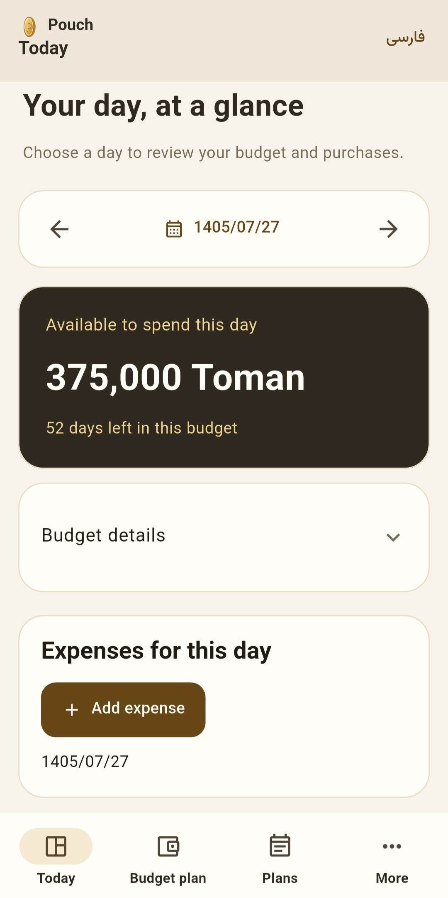
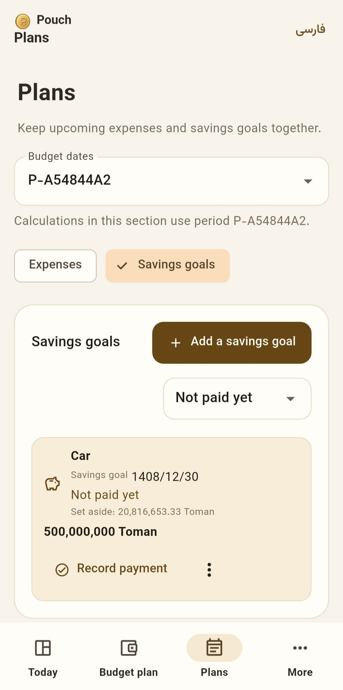
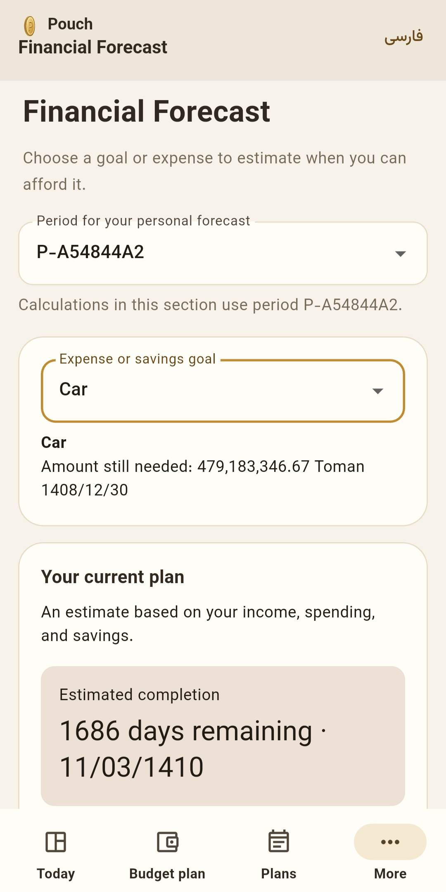
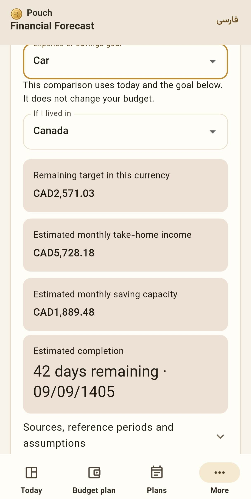
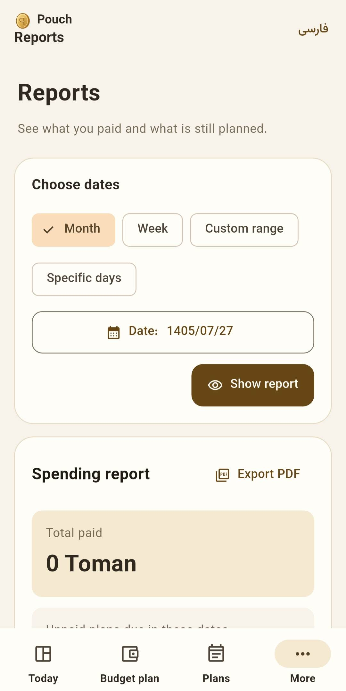
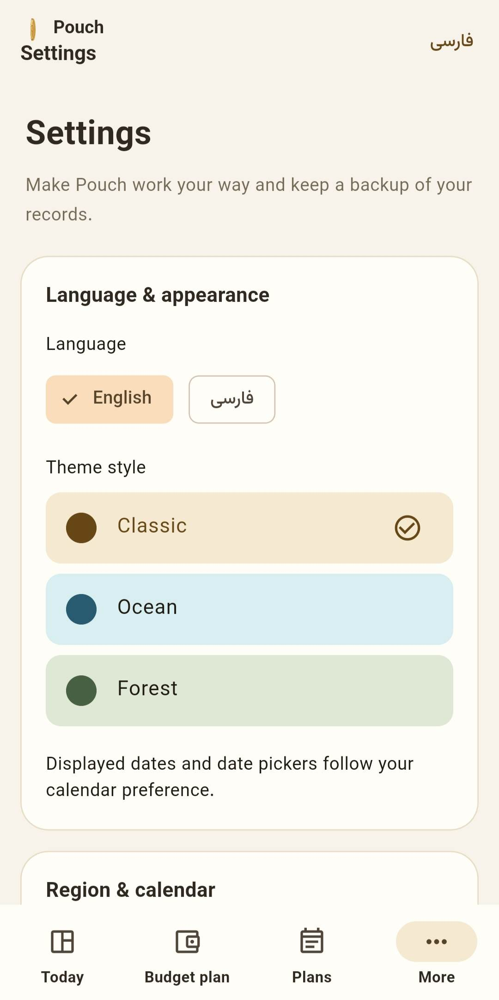
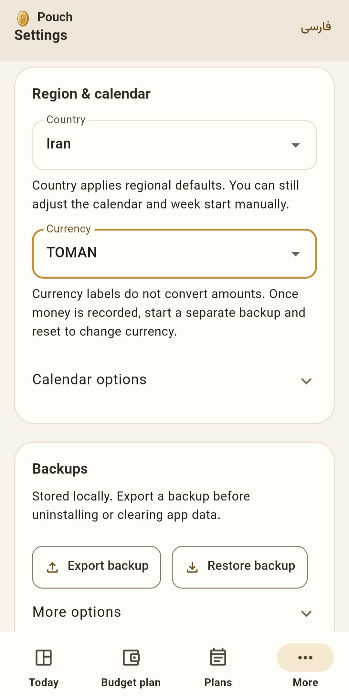

  

# Pouch

Pouch is an offline spending planner with a Flutter interface and a Rust core. Version 2 supports Android, Windows x64, and Linux x64. It helps you plan a budget, record income and purchases, reserve money for upcoming expenses, track savings goals, and prepare reports.

The project is maintained by [AlighasemiQWxp](https://github.com/AlighasemiQWxp).

The default Classic theme uses cream and light brown. The interface bundles Vazirmatn for offline Persian and English text. Mobile navigation groups Today, Budget, and Plans alongside More; desktop navigation exposes the additional tools in the sidebar. About is available from Settings.

Periods can be edited or deleted from Budget Plan. Deletion requires confirmation and is available only for periods without linked financial records. Removing an unused period extends an adjacent period to keep the calendar continuous.

## App walkthrough

These Android screenshots show the English interface with the Classic theme and Jalali dates. Pouch also supports Persian and runs on Linux and Windows.

### 1. Today: review a day and record expenses

  

Choose a date with the calendar or day arrows, review the available spending, and record purchases in the list underneath. Future entries become planned expenses until paid. Budget details expand when needed. The selected period is named above the daily view; changing periods preserves your selected calendar date.

### 2. Budget Plan: manage periods, income, and savings

Create a period, select it from the named period selector, and use Edit period or Delete period to manage it. Deletion requires confirmation and protects periods with linked financial records. Choose a date directly in the income calendar, enter an amount, and press Add Income or Save Income. The active period is selected by default, and assignment is independent of the receipt date. Future income remains expected until received. Savings settings and earlier revisions are available in the same tab.

### 3. Plans: upcoming expenses and savings goals

  

Choose a period, switch between Expenses and Savings goals, and add a target with an amount and date. Each entry can belong to a period independently of its due date. Record payment when money is actually spent; use the entry menu to edit or delete it. Set-aside amounts are budget allocations, not transfers to a separate bank account.

### 4. Financial Forecast: estimate when you can afford a goal

  

Select a period at the top, then choose an expense or savings goal. Review the estimated completion date and expand the budget details or spending scenarios when needed. Forecasts are estimates based on the plan, not guaranteed outcomes.

### 5. Compare a country scenario

  

The country comparison uses today and its own target selection. Explore estimated take-home income, saving capacity, currency conversion, and completion dates without changing your budget. Expand Sources, reference periods and assumptions to inspect the calculation.

### 6. Reports: review spending and export a PDF

  

Choose specific days, a date range, a week, or a month, then press Show report. Reports separate actual spending from unpaid plans and include category totals, daily totals, and individual purchases. Use Export PDF to prepare a printable report.

### 7. Settings: language and appearance

  

Choose English or Persian and select Classic, Ocean, or Forest. Classic is the default cream and light brown theme. Both languages use the bundled Vazirmatn font.

### 8. Settings: regional preferences and backups

  

Country selection supplies regional defaults. Calendar and week start can be adjusted independently. Currency labels do not convert recorded amounts. Export a backup before uninstalling or clearing app data; restore backups from Settings. Recovery and reset controls are under More options.

## Features

- English and Persian interfaces, with right-to-left Persian layouts and Gregorian or Jalali calendars
- Country-based currency, calendar, and week-start defaults, with manual calendar and week-start choices
- Recorded income and future expected income, kept separate until it is marked received
- Backdated income and purchases in Budget Plan and Today, including dates before first use; earlier records extend the first budget plan and carry-forward history
- Income calendar with explicit period choices, editable planning horizons, rollover, period savings plans, and independently recurring essential bills
- Responsive desktop/mobile navigation, daily expenses within Today, combined expenses and savings goals in Plans, and consistent English/Persian presentation
- Financial Forecast with a shared target, clear completion/deadline status, expandable improvements and country comparison (see [Financial Forecast](docs/FINANCIAL_FORECAST.md))
- Standard Forecast with automatic data retrieval for all seven named countries, deadline saving and income requirements, currency conversion, offline caching and optional local assumptions (see [Economic Profiles](docs/ECONOMIC_PROFILES.md))
- Daily spending recommendations with carry-forward balances
- Planned expenses that reserve money until paid
- Automatic savings allocations shared across goals, with funded progress, daily spending adjustments, and completion estimates
- Purchase history available on demand, with editing and undo for recent deletions
- Reports for selected days, date ranges, weeks, and months, with PDF printing on Android
- Local JSON backup and restore, with recovery copies for saved data

Pouch keeps budgeting data on the device. Its recommendations are calculations from recorded income and expenses, not a bank balance or a promise of future income.

Explicit periods retain stable IDs and their original planning calendar; changing the display calendar does not move saved dates. Shared boundaries and plan references are validated transactionally. Only received income funds recommendations. Cash and deficits carry forward without creating synthetic income. Pending expenses are reserved before savings; essential bills are included in that reservation once. Savings allocations are recorded, goal contributions are credited once per period, and goal payments consume them. Backdated corrections replay affected later allocations. Expected income remains separate until received, including when its actual date or amount differs. Financial forecasts are read-only estimates. See [data formats](docs/DATA_FORMAT.md) for the intentional storage break and [architecture](ARCHITECTURE.md) for the accounting rules.

Today shows the spending recommendation, expense entry, and relevant planned expenses. Expense history opens only when requested, with name search and date filtering for paid and planned expenses.

Reports calendars highlight the selected date range, individual days, full week, or full month. Weekly selection follows the chosen week start, and monthly selection follows the Gregorian or Jalali calendar chosen in Settings. Selecting a date updates the corresponding range endpoint, adds an individual day, or chooses the week or month to report.

## Project structure

- flutter contains the application interface, navigation, localization, and platform integration.
- rust contains the budget domain, calculations, backup validation, and persistent storage.
- ARCHITECTURE.md describes module responsibilities and data flow.
- SECURITY.md explains data handling and vulnerability reporting.

## Build and run

Install Flutter, the Android SDK, and the Android NDK version pinned by the Flutter Gradle configuration. From the flutter directory, run:

    flutter pub get
    flutter run

The Android release build uses the application version shown in the About page. Configure a private Android signing key before distributing a release build; keep signing files and passwords outside this repository.

If you change the Rust API, regenerate the Flutter bridge from the flutter directory with flutter_rust_bridge_codegen generate, then build and verify the app manually on an Android device.

## Desktop support

Windows x64 and Linux x64 runners, platform services, and manual packaging scripts are prepared. See [desktop build and acceptance instructions](docs/DESKTOP.md). Version 2 packages have passed manual build and runtime validation on Ubuntu 26.04 x64, Android, and Windows 11. Windows is an unsigned portable release. Ubuntu 24.04 compatibility of the published Linux package has not been verified. The Linux workflow runs on every push to main and on pull requests, and can also be started manually. It checks the Flutter frontend and Rust core, builds the Linux application, and uploads an Actions artifact rather than a release. Results appear in GitHub Actions and commit or pull-request checks.

## Version 3

Version 3.0.0 build 6 corrects repeated goal reservations that could leave Today with no daily allowance. It repairs derived savings allocations when opening earlier Flutter/Rust data or importing supported backups. The maintainer completed Linux validation, built the signed Android package, and confirmed the corrected application works. The Version 3 release notes identify the replacement package source commit, platform CI results, and checksums. See the [changelog](CHANGELOG.md), [release verification record](docs/RELEASE_V3.md), and [GitHub release](https://github.com/AlighasemiQWxp/Pouch/releases/tag/v3.0.0).

## Release signing and validation

Keep the release keystore and its properties file outside this repository. Back them up securely so future versions can use the same key.

Create the private directory first, then generate a keystore with the JDK keytool command. Enter passwords interactively:

    keytool -genkeypair -v -keystore "C:\Private\Pouch\pouch-release.jks" -keyalg RSA -keysize 2048 -validity 10000 -alias pouch

Create `C:/Private/Pouch/signing.properties` with these fields, replacing the placeholders privately. Use forward slashes for the absolute keystore path:

    storeFile=C:/Private/Pouch/pouch-release.jks
    storePassword=YOUR_PRIVATE_STORE_PASSWORD
    keyAlias=pouch
    keyPassword=YOUR_PRIVATE_KEY_PASSWORD

In PowerShell, set the properties file location and run validation from the repository root:

    $env:POUCH_SIGNING_PROPERTIES = "C:\Private\Pouch\signing.properties"
    .\validate-and-build.ps1

The script checks Rust formatting, Clippy and tests, Flutter analysis and available tests, then builds the signed APK at `flutter/build/app/outputs/flutter-apk/app-release.apk`. Debug builds do not require signing credentials. Release builds fail when credentials are missing and never fall back to the debug key.

Verify the new APK on an Android device before publishing. An installation signed with the debug key cannot be updated by this release key. Export a backup before uninstalling that installation, then restore it in the signed app if both installations use the current backup format. Older development backups are intentionally unsupported.

## License

Pouch is covered by the Pouch Source-Available License 1.0 in LICENSE. Third-party dependencies remain under their own licenses.
